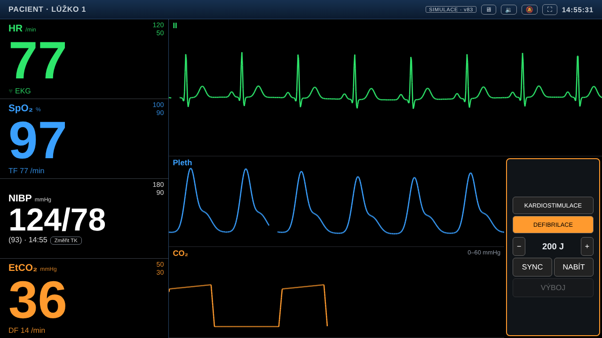
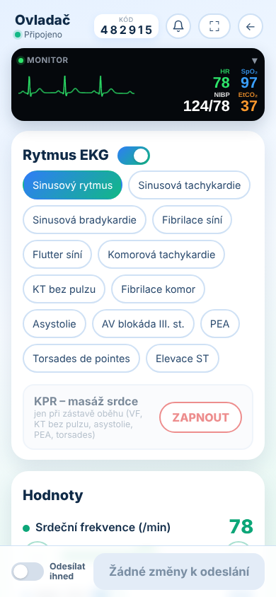

# Simulátor monitoru pacienta

Webová aplikace pro výuku a nácvik práce s monitorem pacienta a defibrilátorem.
Jedno zařízení slouží jako **ovladač** lektora, druhé jako **monitor**, na který se dívají studenti.

**Spuštění:** https://frantisekpfeffer98-ops.github.io/Monitor/

> ⚠️ **Pouze pro výuku a nácvik.** Nejedná se o zdravotnický prostředek. Aplikace nesmí být použita
> k monitoraci ani léčbě skutečných pacientů. Křivky a hodnoty jsou zjednodušené a nejsou klinicky ověřené.



## Jak začít

1. Otevři aplikaci na dvou zařízeních (telefon, tablet nebo počítač).
2. Na obou zadej stejný 6místný kód pro spárování (při každém spuštění se nabídne nový náhodný).
3. Na prvním zařízení spusť **Ovladač**.
4. Na druhém zařízení spusť **Monitor**.

Obě zařízení potřebují internet. Pokud se nespárují na Wi-Fi (školní a nemocniční sítě někdy
přímé spojení blokují), zapni na jednom telefonu hotspot a připoj na něj druhé zařízení.
Ovladač i monitor by měly mít stejnou verzi aplikace (číslo verze je dole na úvodní obrazovce).

## Ovladač (lektor)



- **Rytmus EKG:** sinusový rytmus, sinusová tachykardie a bradykardie, fibrilace a flutter síní,
  komorová tachykardie (s pulzem i bez pulzu), fibrilace komor, asystolie, AV blokáda III. stupně,
  PEA, torsades de pointes, elevace ST.
- **Hodnoty:** srdeční frekvence, SpO₂, krevní tlak, EtCO₂, dechová frekvence – posuvníky a tlačítka −/+.
  Rozsah tepu se řídí zvoleným rytmem.
- **Přepínače senzorů:** EKG, SpO₂, EtCO₂. Po spuštění jsou všechny vypnuté.
- **KPR:** u rytmů bez pulzu přidá na EKG artefakt kompresí, kapnogram ukazuje ventilaci ambu vakem.
- **Hranice alarmů** (ikona zvonku) pro tep, SpO₂, systolický tlak a EtCO₂.
- **UPDATE / Odesílat ihned:** změny se na monitor posílají tlačítkem, nebo okamžitě.
- **Náhled monitoru** nahoře ukazuje, co je právě na monitoru, včetně stavu defibrilátoru
  a stimulace (lze sbalit ťuknutím).

## Monitor (studenti)

- Křivky EKG (svod II), pletysmografie a kapnografie, číselné hodnoty a alarmy se zvuky podle priority.
- **NIBP** se měří tlačítkem „Změřit TK“ (asi 20 s), do prvního měření je `---/---`.
- **Defibrilace:** volba energie, nabíjení, výboj, **synchronizovaná kardioverze** (SYNC – výboj na
  příštím QRS, po výboji se SYNC vypne).
- **Kardiostimulace:** frekvence a proud, zachycení od 70 mA, pauza 5 s.
- Na telefonu se monitor vždy zobrazí na šířku. Hlasitost má 4 úrovně, alarmy lze na 2 minuty ztlumit.

## Instalace na plochu

- **Android:** otevři adresu v **Google Chrome** → ⋮ → *Přidat na plochu* / *Instalovat*.
  (Instalace přes Samsung Internet může skončit varováním Google Play Protect.)
- **iPhone:** otevři adresu v **Safari** → Sdílet → *Přidat na plochu*.

## Technické informace

- Statická webová aplikace (`index.html`, `style.css`, `app.js`), bez serveru a bez sestavování; hostováno na GitHub Pages.
- Testovací verze pro zkoušení změn před nasazením: https://frantisekpfeffer98-ops.github.io/Monitor/test/
- Spojení mezi zařízeními přes WebRTC pomocí knihovny [PeerJS](https://github.com/peers/peerjs)
  1.5.4 (MIT), přibalené jako `peerjs.min.js`. K nalezení protějšku se používá veřejný server PeerJS.
- Žádná data se neukládají na server; ovladač si nastavení pamatuje jen v prohlížeči daného zařízení.

## Automatické testy

Složka `tests/` obsahuje automatické testy, které aplikaci vyzkoušejí v prohlížeči bez okna
(rytmy a jejich rozsahy, zámky posuvníků, KPR, alarmy, SpO₂ a TF, defibrilace a SYNC, pauza po výboji,
kardiostimulace, NIBP, odesílání změn, rozložení na různých displejích). Spojení mezi zařízeními
se při testech jen předstírá, takže testy nepotřebují internet.

GitHub je spouští automaticky při každé změně (záložka **Actions**). Ručně:

```bash
npm install
npx playwright install chromium
npm test                 # ostrá verze
npm run test:testovaci   # verze v /test/
```

## Autor

František Pfeffer
